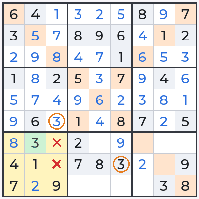

<!-- Written by tools/walkthrough.py anti-diagonal: edit the script, not this page. -->
# Anti-Diagonal, step 38: the 3 in box 7

**Step 38 of 49** · [← Step 37](step-37.md) · [All steps](../anti-diagonal.md#the-whole-puzzle-step-by-step) · [Step 39 →](step-39.md)

Box 7 needs a 3. r7c3: column 3 has one (r6c3). r8c3: row 8 has one (r8c6). Only **r7c2** is left: **r7c2 = 3**.

**Step 38 of 49** · [← Step 37](step-37.md) · [All steps](../anti-diagonal.md#the-whole-puzzle-step-by-step) · [Step 39 →](step-39.md)
