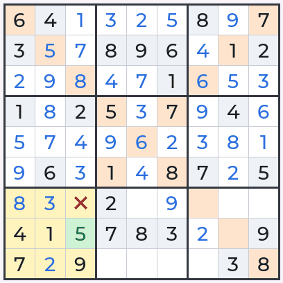

<!-- Written by tools/walkthrough.py anti-diagonal: edit the script, not this page. -->
# Anti-Diagonal, step 39: the 5 in box 7

**Step 39 of 49** · [← Step 38](step-38.md) · [All steps](../anti-diagonal.md#the-whole-puzzle-step-by-step) · [Step 40 →](step-40.md)

Box 7 needs a 5. r7c3: its long diagonal holds 1, 6 and 7 already, three different digits at most. Only **r8c3** is left: **r8c3 = 5**.

**Step 39 of 49** · [← Step 38](step-38.md) · [All steps](../anti-diagonal.md#the-whole-puzzle-step-by-step) · [Step 40 →](step-40.md)
