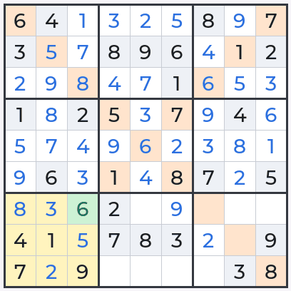

<!-- Written by tools/walkthrough.py anti-diagonal: edit the script, not this page. -->
# Anti-Diagonal, step 40: the 6 in box 7

**Step 40 of 49** · [← Step 39](step-39.md) · [All steps](../anti-diagonal.md#the-whole-puzzle-step-by-step) · [Step 41 →](step-41.md)

Box 7 needs a 6, and r7c3 is its last empty cell: **r7c3 = 6**.

**Step 40 of 49** · [← Step 39](step-39.md) · [All steps](../anti-diagonal.md#the-whole-puzzle-step-by-step) · [Step 41 →](step-41.md)
