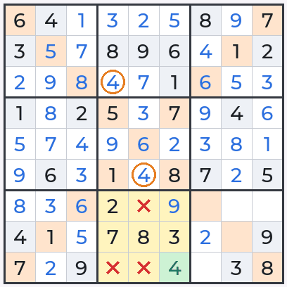

<!-- Written by tools/walkthrough.py anti-diagonal: edit the script, not this page. -->
# Anti-Diagonal, step 41: the 4 in box 8

**Step 41 of 49** · [← Step 40](step-40.md) · [All steps](../anti-diagonal.md#the-whole-puzzle-step-by-step) · [Step 42 →](step-42.md)

Box 8 needs a 4. r7c5 and r9c5: column 5 has one (r6c5). r9c4: column 4 has one (r3c4). Only **r9c6** is left: **r9c6 = 4**.

**Step 41 of 49** · [← Step 40](step-40.md) · [All steps](../anti-diagonal.md#the-whole-puzzle-step-by-step) · [Step 42 →](step-42.md)
