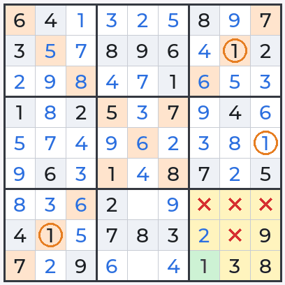

<!-- Written by tools/walkthrough.py anti-diagonal: edit the script, not this page. -->
# Anti-Diagonal, step 43: the 1 in box 9

**Step 43 of 49** · [← Step 42](step-42.md) · [All steps](../anti-diagonal.md#the-whole-puzzle-step-by-step) · [Step 44 →](step-44.md)

Box 9 needs a 1. r7c8: column 8 has one (r2c8). r7c9: column 9 has one (r5c9). r8c8: row 8 has one (r8c2). r7c7: its long diagonal holds 5, 6 and 8 already, three different digits at most. Only **r9c7** is left: **r9c7 = 1**.

**Step 43 of 49** · [← Step 42](step-42.md) · [All steps](../anti-diagonal.md#the-whole-puzzle-step-by-step) · [Step 44 →](step-44.md)
