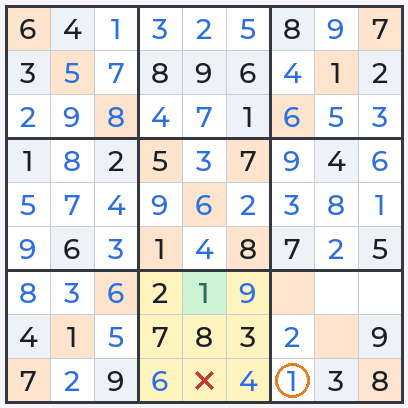

<!-- Written by tools/walkthrough.py anti-diagonal: edit the script, not this page. -->
# Anti-Diagonal, step 44: the 1 in box 8

**Step 44 of 49** · [← Step 43](step-43.md) · [All steps](../anti-diagonal.md#the-whole-puzzle-step-by-step) · [Step 45 →](step-45.md)

Box 8 needs a 1. r9c5: row 9 has one (r9c7). Only **r7c5** is left: **r7c5 = 1**.

**Step 44 of 49** · [← Step 43](step-43.md) · [All steps](../anti-diagonal.md#the-whole-puzzle-step-by-step) · [Step 45 →](step-45.md)
