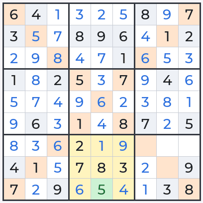

<!-- Written by tools/walkthrough.py anti-diagonal: edit the script, not this page. -->
# Anti-Diagonal, step 45: the 5 in box 8

**Step 45 of 49** · [← Step 44](step-44.md) · [All steps](../anti-diagonal.md#the-whole-puzzle-step-by-step) · [Step 46 →](step-46.md)

Box 8 needs a 5, and r9c5 is its last empty cell: **r9c5 = 5**.

**Step 45 of 49** · [← Step 44](step-44.md) · [All steps](../anti-diagonal.md#the-whole-puzzle-step-by-step) · [Step 46 →](step-46.md)
