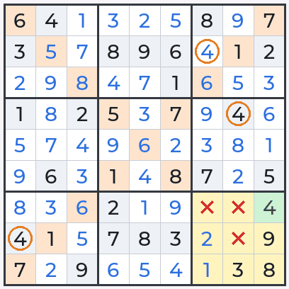

<!-- Written by tools/walkthrough.py anti-diagonal: edit the script, not this page. -->
# Anti-Diagonal, step 46: the 4 in box 9

**Step 46 of 49** · [← Step 45](step-45.md) · [All steps](../anti-diagonal.md#the-whole-puzzle-step-by-step) · [Step 47 →](step-47.md)

Box 9 needs a 4. r7c7: column 7 has one (r2c7). r7c8: column 8 has one (r4c8). r8c8: row 8 has one (r8c1). Only **r7c9** is left: **r7c9 = 4**.

**Step 46 of 49** · [← Step 45](step-45.md) · [All steps](../anti-diagonal.md#the-whole-puzzle-step-by-step) · [Step 47 →](step-47.md)
