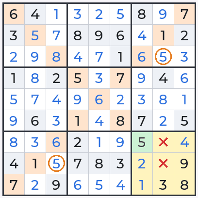

<!-- Written by tools/walkthrough.py anti-diagonal: edit the script, not this page. -->
# Anti-Diagonal, step 47: the 5 in box 9

**Step 47 of 49** · [← Step 46](step-46.md) · [All steps](../anti-diagonal.md#the-whole-puzzle-step-by-step) · [Step 48 →](step-48.md)

Box 9 needs a 5. r7c8: column 8 has one (r3c8). r8c8: row 8 has one (r8c3). Only **r7c7** is left: **r7c7 = 5**.

**Step 47 of 49** · [← Step 46](step-46.md) · [All steps](../anti-diagonal.md#the-whole-puzzle-step-by-step) · [Step 48 →](step-48.md)
