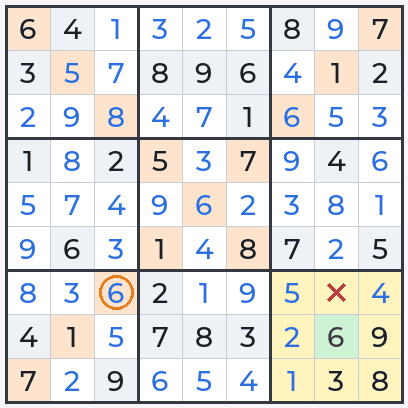

<!-- Written by tools/walkthrough.py anti-diagonal: edit the script, not this page. -->
# Anti-Diagonal, step 48: the 6 in box 9

**Step 48 of 49** · [← Step 47](step-47.md) · [All steps](../anti-diagonal.md#the-whole-puzzle-step-by-step) · [Step 49 →](step-49.md)

Box 9 needs a 6. r7c8: row 7 has one (r7c3). Only **r8c8** is left: **r8c8 = 6**.

**Step 48 of 49** · [← Step 47](step-47.md) · [All steps](../anti-diagonal.md#the-whole-puzzle-step-by-step) · [Step 49 →](step-49.md)
