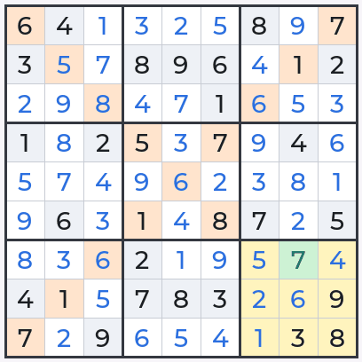

<!-- Written by tools/walkthrough.py anti-diagonal: edit the script, not this page. -->
# Anti-Diagonal, step 49: the 7 in box 9

**Step 49 of 49** · [← Step 48](step-48.md) · [All steps](../anti-diagonal.md#the-whole-puzzle-step-by-step) · [All steps](../anti-diagonal.md#the-whole-puzzle-step-by-step)

Box 9 needs a 7, and r7c8 is its last empty cell: **r7c8 = 7**.

Solved.

**Step 49 of 49** · [← Step 48](step-48.md) · [All steps](../anti-diagonal.md#the-whole-puzzle-step-by-step) · [All steps](../anti-diagonal.md#the-whole-puzzle-step-by-step)
