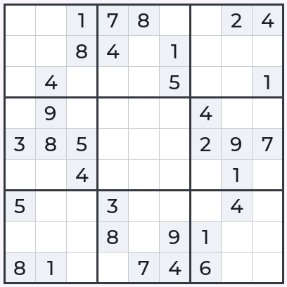

# Anti-King

[← All variants](README.md) · [Puzzles](../features-puzzles.md) · [How to play](../how-to-play.md)

## The rules

[Classic](classic.md) rules, and two cells that **touch**, also **corner to corner** (a chess king's move), never hold the same digit. Side by side they already share a row or column, so what's new are the four diagonal neighbours: a digit rules out the cells touching its corners, even across a box border.

## On the board

- Nothing extra is drawn.
- A digit repeated in a touching cell turns red; selecting a cell highlights its touching cells along with its row, column and box. Hints say "a touching cell".
- The rules card draws a 5 with the eight cells around it crossed out.
- **Puzzles → ⋮ → New puzzle → Anti-King**.

## How to solve it

- Every digit rules out its four diagonal neighbours. That matters most **across box borders**: a digit at a box's edge reaches the corner cells of the next box, where the Classic rules don't.
- For a hidden single in a column, check the cells at the column's box borders: a digit in the next column over, one row up or down, takes them out.
- A 3×3 box's centre touches all eight other cells of its box (no news there) but nothing outside; its corner cells touch three other boxes.

## Worked example

**variant-examples #13**, Anti-King Easy (see [Classic](classic.md#worked-example-the-whole-puzzle) for how to import the examples; cells are written r*row*c*column*).

**Step 1: the 5 in column 4.** Column 4 needs a 5; its empty cells are r3c4, r4c4, r5c4, r6c4 and r9c4.

- r3c4: row 3 has a 5 (r3c6).
- r5c4: row 5 has a 5 (r5c3).
- r4c4 and r6c4: they **touch r5c3**, the 5, at a corner (one row up or down, one column right). Box 5 has no 5 yet, so by the Classic rules both would still be open.

Only **r9c4** is left: **r9c4 = 5**.

**Step 2: the 5 in column 5.** Its empty cells: r2c5, r3c5, r4c5, r5c5, r6c5, r7c5 and r8c5.

- r2c5, r3c5: box 2 and row 3 have a 5 (r3c6).
- r4c5: it **touches r3c6** at a corner (one row down, one column left).
- r5c5: row 5 has a 5; r7c5: row 7 has a 5 (r7c1); r8c5: box 8 now has the 5 from step 1.

Only **r6c5** is left: **r6c5 = 5**.

**Step 3: the 2 in column 6.** Its empty cells: r1c6, r4c6, r5c6, r6c6 and r7c6.

- r1c6: row 1 has a 2 (r1c8).
- r5c6: row 5 has a 2 (r5c7).
- r4c6 and r6c6: they **touch r5c7**, the 2, at a corner.

Only **r7c6** is left: **r7c6 = 2**. In all three steps the deciding cells were across a box border from the digit that ruled them out.

## The whole puzzle, step by step

<!-- walkthrough -->
<!-- Written by tools/walkthrough.py anti-king: edit the script, not this part. -->

The whole puzzle, from the start to the last cell: 49 steps, each one a single (one place left for a digit, or one digit left for a cell), taken in the order a box's single comes first, so not quite the order of the worked example above. Each step has a page of its own, with **Previous** and **Next**: pick its number below. In each picture, the unit the step looks at is tinted yellow (for a cell with one digit left: its row, column and box), the new digit is on green, the digits that rule cells out have an **orange ring**, and the empty cells they rule out a **red cross**. Givens are on grey, digits from earlier steps in blue.

| [1](anti-king/step-01.md) | [2](anti-king/step-02.md) | [3](anti-king/step-03.md) | [4](anti-king/step-04.md) | [5](anti-king/step-05.md) | [6](anti-king/step-06.md) | [7](anti-king/step-07.md) | [8](anti-king/step-08.md) | [9](anti-king/step-09.md) | [10](anti-king/step-10.md) |
|:-:|:-:|:-:|:-:|:-:|:-:|:-:|:-:|:-:|:-:|
| [11](anti-king/step-11.md) | [12](anti-king/step-12.md) | [13](anti-king/step-13.md) | [14](anti-king/step-14.md) | [15](anti-king/step-15.md) | [16](anti-king/step-16.md) | [17](anti-king/step-17.md) | [18](anti-king/step-18.md) | [19](anti-king/step-19.md) | [20](anti-king/step-20.md) |
| [21](anti-king/step-21.md) | [22](anti-king/step-22.md) | [23](anti-king/step-23.md) | [24](anti-king/step-24.md) | [25](anti-king/step-25.md) | [26](anti-king/step-26.md) | [27](anti-king/step-27.md) | [28](anti-king/step-28.md) | [29](anti-king/step-29.md) | [30](anti-king/step-30.md) |
| [31](anti-king/step-31.md) | [32](anti-king/step-32.md) | [33](anti-king/step-33.md) | [34](anti-king/step-34.md) | [35](anti-king/step-35.md) | [36](anti-king/step-36.md) | [37](anti-king/step-37.md) | [38](anti-king/step-38.md) | [39](anti-king/step-39.md) | [40](anti-king/step-40.md) |
| [41](anti-king/step-41.md) | [42](anti-king/step-42.md) | [43](anti-king/step-43.md) | [44](anti-king/step-44.md) | [45](anti-king/step-45.md) | [46](anti-king/step-46.md) | [47](anti-king/step-47.md) | [48](anti-king/step-48.md) | [49](anti-king/step-49.md) |  |

Solved.

<!-- /walkthrough -->
