# Anti-King

[← All variants](README.md) · [Puzzles](../features-puzzles.md) · [How to play](../how-to-play.md)


## The rules

[Classic](classic.md) rules, and two cells that **touch**, also **corner to corner** (a chess king's move), never hold the same digit. Side by side they already share a row or column, so what's new are the four diagonal neighbours: a digit rules out the cells touching its corners, even across a box border.

## On the board

- Nothing extra is drawn.
- A digit repeated in a touching cell turns red; selecting a cell highlights its touching cells along with its row, column and box. Hints say "a touching cell".
- The rules card draws a 5 with the eight cells around it crossed out.
- **Puzzles → ⋮ → New puzzle → Anti-King**.

## How to solve it

- Every digit rules out its four diagonal neighbours. That matters most **across box borders**: a digit at a box's edge reaches the corner cells of the next box, where the Classic rules don't.
- For a hidden single in a column, check the cells at the column's box borders: a digit in the next column over, one row up or down, takes them out.
- A 3×3 box's centre touches all eight other cells of its box (no news there) but nothing outside; its corner cells touch three other boxes.

## Worked example

**variant-examples #13**, Anti-King Easy (see [Classic](classic.md#worked-example) for how to import the examples; cells are written r*row*c*column*).

```
. . 1 | 7 8 . | . 2 4
. . 8 | 4 . 1 | . . .
. 4 . | . . 5 | . . 1
------+-------+------
. 9 . | . . . | 4 . .
3 8 5 | . . . | 2 9 7
. . 4 | . . . | . 1 .
------+-------+------
5 . . | 3 . . | . 4 .
. . . | 8 . 9 | 1 . .
8 1 . | . 7 4 | 6 . .
```

**Step 1: the 5 in column 4.** Column 4 needs a 5; its empty cells are r3c4, r4c4, r5c4, r6c4 and r9c4.

- r3c4: row 3 has a 5 (r3c6).
- r5c4: row 5 has a 5 (r5c3).
- r4c4 and r6c4: they **touch r5c3**, the 5, at a corner (one row up or down, one column right). Box 5 has no 5 yet, so by the Classic rules both would still be open.

Only **r9c4** is left: **r9c4 = 5**.

**Step 2: the 5 in column 5.** Its empty cells: r2c5, r3c5, r4c5, r5c5, r6c5, r7c5 and r8c5.

- r2c5, r3c5: box 2 and row 3 have a 5 (r3c6).
- r4c5: it **touches r3c6** at a corner (one row down, one column left).
- r5c5: row 5 has a 5; r7c5: row 7 has a 5 (r7c1); r8c5: box 8 now has the 5 from step 1.

Only **r6c5** is left: **r6c5 = 5**.

**Step 3: the 2 in column 6.** Its empty cells: r1c6, r4c6, r5c6, r6c6 and r7c6.

- r1c6: row 1 has a 2 (r1c8).
- r5c6: row 5 has a 2 (r5c7).
- r4c6 and r6c6: they **touch r5c7**, the 2, at a corner.

Only **r7c6** is left: **r7c6 = 2**. In all three steps the deciding cells were across a box border from the digit that ruled them out.

## The whole puzzle, step by step

<!-- walkthrough -->
<!-- Written by tools/walkthrough.py anti-king: edit the script, not this part. -->

The whole puzzle, from the start to the last cell: 49 steps, each one a single (one place left for a digit, or one digit left for a cell), taken in the order a box's single comes first, so not quite the order of the worked example above. In each picture, the unit the step looks at is tinted yellow (for a cell with one digit left: its row, column and box), the new digit is on green, the digits that rule cells out have an **orange ring**, and the empty cells they rule out a **red cross**. Givens are on grey, digits from earlier steps in blue.


#### Step 1: the 1 in box 4

Box 4 needs a 1. r4c3: column 3 has one (r1c3). r6c1 and r6c2: row 6 has one (r6c8). Only **r4c1** is left: **r4c1 = 1**.


#### Step 2: the 4 in box 5

Box 5 needs a 4. r4c4, r4c5 and r4c6: row 4 has one (r4c7). r5c4: column 4 has one (r2c4). r5c6: column 6 has one (r9c6). r6c4, r6c5 and r6c6: row 6 has one (r6c3). Only **r5c5** is left: **r5c5 = 4**.


#### Step 3: the 1 in box 5

Box 5 needs a 1. r4c4, r4c5 and r4c6: row 4 has one (r4c1). r5c6: column 6 has one (r2c6). r6c4, r6c5 and r6c6: row 6 has one (r6c8). Only **r5c4** is left: **r5c4 = 1**.


#### Step 4: the 5 in box 5

Box 5 needs a 5. r4c4 and r6c4: touch the 5 in r5c3 at a corner. r4c5: touches the 5 in r3c6 at a corner. r4c6 and r6c6: column 6 has one (r3c6). r5c6: row 5 has one (r5c3). Only **r6c5** is left: **r6c5 = 5**.


#### Step 5: the 9 in box 5

Box 5 needs a 9. r4c4, r4c5 and r4c6: row 4 has one (r4c2). r5c6: row 5 has one (r5c8). r6c6: column 6 has one (r8c6). Only **r6c4** is left: **r6c4 = 9**.


#### Step 6: the 4 in box 7

Box 7 needs a 4. r7c2 and r7c3: row 7 has one (r7c8). r8c2: column 2 has one (r3c2). r8c3: column 3 has one (r6c3). r9c3: row 9 has one (r9c6). Only **r8c1** is left: **r8c1 = 4**.


#### Step 7: the 9 in box 7

Box 7 needs a 9. r7c2: column 2 has one (r4c2). r7c3: touches the 9 in r6c4 at a corner. r8c2 and r8c3: row 8 has one (r8c6). Only **r9c3** is left: **r9c3 = 9**.

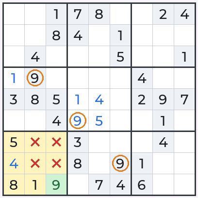

#### Step 8: the 3 in box 7

Box 7 needs a 3. r7c2 and r7c3: row 7 has one (r7c4). r8c3: touches the 3 in r7c4 at a corner. Only **r8c2** is left: **r8c2 = 3**.

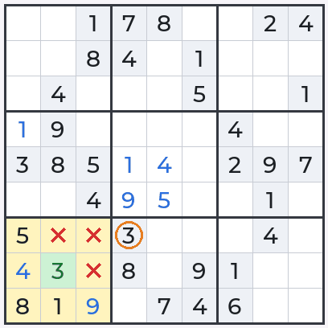

#### Step 9: the 3 in box 1

Box 1 needs a 3. r1c1, r2c1 and r3c1: column 1 has one (r5c1). r1c2 and r2c2: column 2 has one (r8c2). Only **r3c3** is left: **r3c3 = 3**.


#### Step 10: the 1 in box 8

Box 8 needs a 1. r7c6: column 6 has one (r2c6). r8c5: row 8 has one (r8c7). r9c4: row 9 has one (r9c2). Only **r7c5** is left: **r7c5 = 1**.

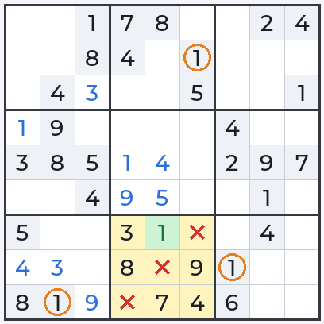

#### Step 11: the 5 in box 8

Box 8 needs a 5. r7c6: row 7 has one (r7c1). r8c5: column 5 has one (r6c5). Only **r9c4** is left: **r9c4 = 5**.


#### Step 12: the 9 in box 9

Box 9 needs a 9. r7c7: touches the 9 in r8c6 at a corner. r8c8 and r8c9: row 8 has one (r8c6). r9c8 and r9c9: row 9 has one (r9c3). Only **r7c9** is left: **r7c9 = 9**.

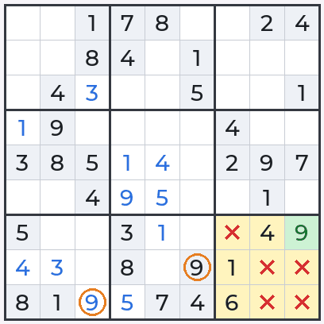

#### Step 13: the 8 in box 9

Box 9 needs an 8. r8c8 and r8c9: row 8 has one (r8c4). r9c8 and r9c9: row 9 has one (r9c1). Only **r7c7** is left: **r7c7 = 8**.

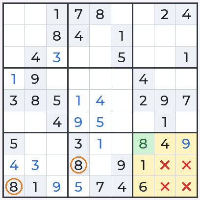

#### Step 14: the 8 in box 3

Box 3 needs an 8. r1c7: row 1 has one (r1c5). r2c7, r2c8 and r2c9: row 2 has one (r2c3). r3c7: column 7 has one (r7c7). Only **r3c8** is left: **r3c8 = 8**.

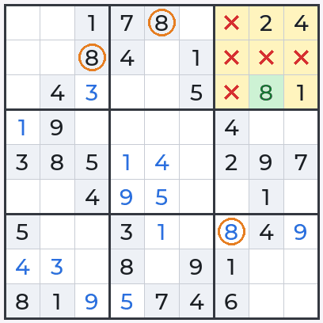

#### Step 15: the 8 in box 5

Box 5 needs an 8. r4c4: column 4 has one (r8c4). r4c5: column 5 has one (r1c5). r5c6: row 5 has one (r5c2). r6c6: touches the 8 in r7c7 at a corner. Only **r4c6** is left: **r4c6 = 8**.


#### Step 16: the 7 in box 5

Box 5 needs a 7. r4c4: column 4 has one (r1c4). r4c5: column 5 has one (r9c5). r5c6: row 5 has one (r5c9). Only **r6c6** is left: **r6c6 = 7**.


#### Step 17: the 7 in box 4

Box 4 needs a 7. r6c1 and r6c2: row 6 has one (r6c6). Only **r4c3** is left: **r4c3 = 7**.

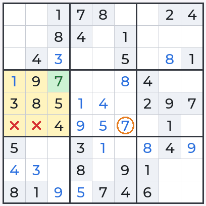

#### Step 18: the 3 in box 5

Box 5 needs a 3. r4c4: column 4 has one (r7c4). r5c6: row 5 has one (r5c1). Only **r4c5** is left: **r4c5 = 3**.

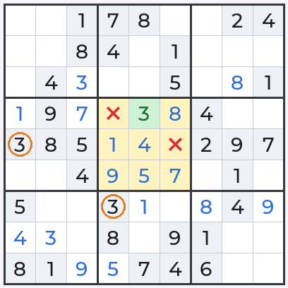

#### Step 19: the 3 in box 2

Box 2 needs a 3. r2c5: column 5 has one (r4c5). r3c4 and r3c5: row 3 has one (r3c3). Only **r1c6** is left: **r1c6 = 3**.

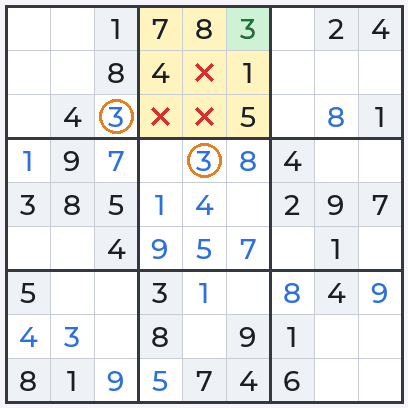

#### Step 20: the 2 in box 5

Box 5 needs a 2. r5c6: row 5 has one (r5c7). Only **r4c4** is left: **r4c4 = 2**.


#### Step 21: the 2 in box 2

Box 2 needs a 2. r3c4: column 4 has one (r4c4). r3c5: touches the 2 in r4c4 at a corner. Only **r2c5** is left: **r2c5 = 2**.


#### Step 22: the 2 in box 1

Box 1 needs a 2. r1c1 and r1c2: row 1 has one (r1c8). r2c1 and r2c2: row 2 has one (r2c5). Only **r3c1** is left: **r3c1 = 2**.


#### Step 23: the 9 in box 2

Box 2 needs a 9. r3c4: column 4 has one (r6c4). Only **r3c5** is left: **r3c5 = 9**.


#### Step 24: the 6 in box 2

Box 2 needs a 6, and r3c4 is its last empty cell: **r3c4 = 6**.


#### Step 25: the 2 in box 4

Box 4 needs a 2. r6c1: column 1 has one (r3c1). Only **r6c2** is left: **r6c2 = 2**.

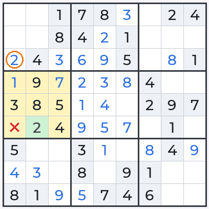

#### Step 26: the 6 in box 4

Box 4 needs a 6, and r6c1 is its last empty cell: **r6c1 = 6**.

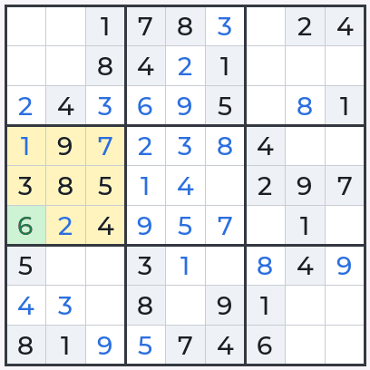

#### Step 27: the 6 in box 5

Box 5 needs a 6, and r5c6 is its last empty cell: **r5c6 = 6**.


#### Step 28: the 8 in box 6

Box 6 needs an 8. r4c8 and r4c9: row 4 has one (r4c6). r6c7: column 7 has one (r7c7). Only **r6c9** is left: **r6c9 = 8**.


#### Step 29: the 3 in box 6

Box 6 needs a 3. r4c8 and r4c9: row 4 has one (r4c5). Only **r6c7** is left: **r6c7 = 3**.

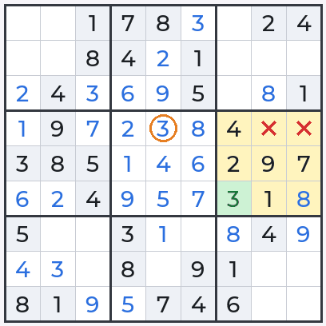

#### Step 30: the 2 in box 7

Box 7 needs a 2. r7c2: column 2 has one (r6c2). r7c3: touches the 2 in r6c2 at a corner. Only **r8c3** is left: **r8c3 = 2**.

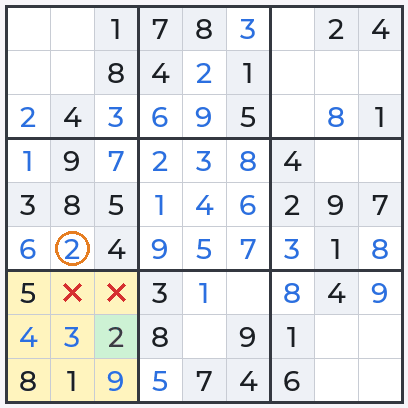

#### Step 31: the 6 in box 7

Box 7 needs a 6. r7c2: touches the 6 in r6c1 at a corner. Only **r7c3** is left: **r7c3 = 6**.


#### Step 32: the 7 in box 7

Box 7 needs a 7, and r7c2 is its last empty cell: **r7c2 = 7**.

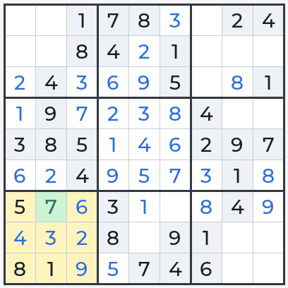

#### Step 33: the 7 in box 1

Box 1 needs a 7. r1c1 and r1c2: row 1 has one (r1c4). r2c2: column 2 has one (r7c2). Only **r2c1** is left: **r2c1 = 7**.

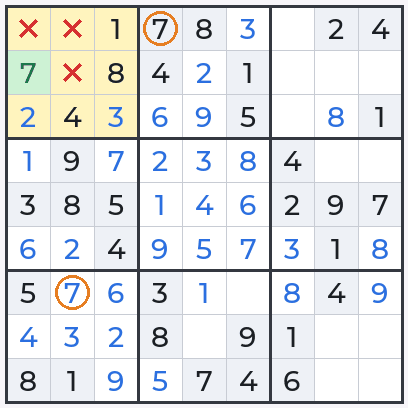

#### Step 34: the 9 in box 1

Box 1 needs a 9. r1c2 and r2c2: column 2 has one (r4c2). Only **r1c1** is left: **r1c1 = 9**.

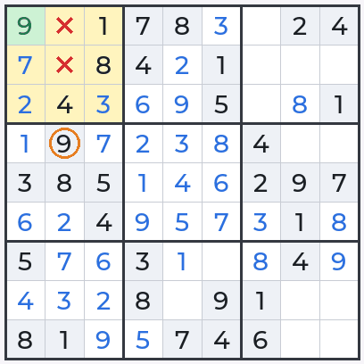

#### Step 35: the 7 in box 3

Box 3 needs a 7. r1c7: row 1 has one (r1c4). r2c7, r2c8 and r2c9: row 2 has one (r2c1). Only **r3c7** is left: **r3c7 = 7**.

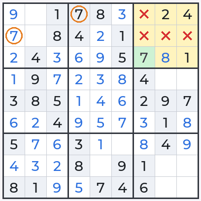

#### Step 36: the 9 in box 3

Box 3 needs a 9. r1c7: row 1 has one (r1c1). r2c8: column 8 has one (r5c8). r2c9: column 9 has one (r7c9). Only **r2c7** is left: **r2c7 = 9**.

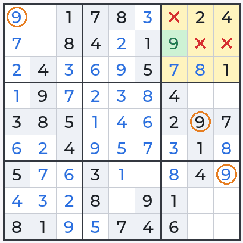

#### Step 37: the 2 in box 8

Box 8 needs a 2. r8c5: row 8 has one (r8c3). Only **r7c6** is left: **r7c6 = 2**.


#### Step 38: the 6 in box 8

Box 8 needs a 6, and r8c5 is its last empty cell: **r8c5 = 6**.


#### Step 39: the 2 in box 9

Box 9 needs a 2. r8c8 and r8c9: row 8 has one (r8c3). r9c8: column 8 has one (r1c8). Only **r9c9** is left: **r9c9 = 2**.


#### Step 40: the 3 in box 9

Box 9 needs a 3. r8c8 and r8c9: row 8 has one (r8c2). Only **r9c8** is left: **r9c8 = 3**.


#### Step 41: the 3 in box 3

Box 3 needs a 3. r1c7: row 1 has one (r1c6). r2c8: column 8 has one (r9c8). Only **r2c9** is left: **r2c9 = 3**.


#### Step 42: the 6 in box 3

Box 3 needs a 6. r1c7: column 7 has one (r9c7). Only **r2c8** is left: **r2c8 = 6**.

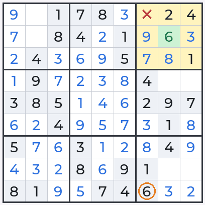

#### Step 43: the 6 in box 1

Box 1 needs a 6. r2c2: row 2 has one (r2c8). Only **r1c2** is left: **r1c2 = 6**.

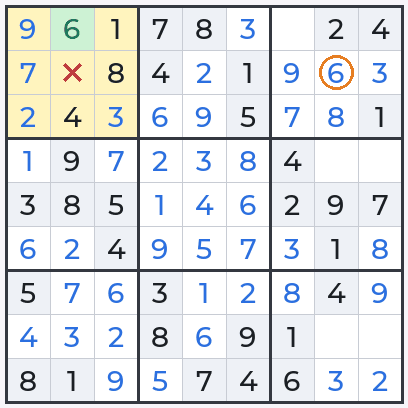

#### Step 44: the 5 in box 1

Box 1 needs a 5, and r2c2 is its last empty cell: **r2c2 = 5**.


#### Step 45: the 5 in box 3

Box 3 needs a 5, and r1c7 is its last empty cell: **r1c7 = 5**.


#### Step 46: the 6 in box 6

Box 6 needs a 6. r4c8: column 8 has one (r2c8). Only **r4c9** is left: **r4c9 = 6**.


#### Step 47: the 5 in box 6

Box 6 needs a 5, and r4c8 is its last empty cell: **r4c8 = 5**.


#### Step 48: the 5 in box 9

Box 9 needs a 5. r8c8: column 8 has one (r4c8). Only **r8c9** is left: **r8c9 = 5**.


#### Step 49: the 7 in box 9

Box 9 needs a 7, and r8c8 is its last empty cell: **r8c8 = 7**.

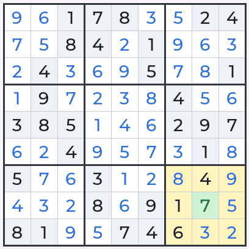

Solved.

<!-- /walkthrough -->
