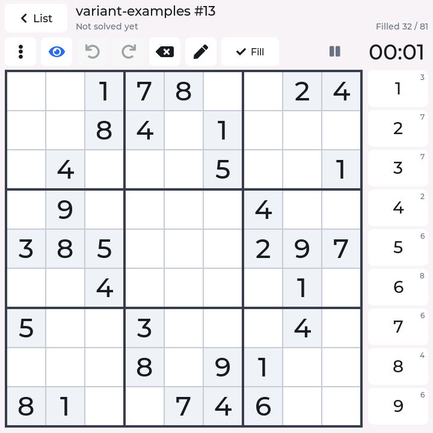

# Anti-King

[← All variants](README.md) · [Puzzles](../features-puzzles.md) · [How to play](../how-to-play.md)



## The rules

[Classic](classic.md) rules, and two cells that **touch**, also **corner to corner** (a chess king's move), never hold the same digit. Side by side they already share a row or column, so what's new are the four diagonal neighbours: a digit rules out the cells touching its corners, even across a box border.

## On the board

- Nothing extra is drawn.
- A digit repeated in a touching cell turns red; selecting a cell highlights its touching cells along with its row, column and box. Hints say "a touching cell".
- The rules card draws a 5 with the eight cells around it crossed out.
- **Puzzles → ⋮ → New puzzle → Anti-King**.

## How to solve it

- Every digit rules out its four diagonal neighbours. That matters most **across box borders**: a digit at a box's edge reaches the corner cells of the next box, where the Classic rules don't.
- For a hidden single in a column, check the cells at the column's box borders: a digit in the next column over, one row up or down, takes them out.
- A 3×3 box's centre touches all eight other cells of its box (no news there) but nothing outside; its corner cells touch three other boxes.

## Worked example

**variant-examples #13**, Anti-King Easy (see [Classic](classic.md#worked-example) for how to import the examples; cells are written r*row*c*column*).

```
. . 1 | 7 8 . | . 2 4
. . 8 | 4 . 1 | . . .
. 4 . | . . 5 | . . 1
------+-------+------
. 9 . | . . . | 4 . .
3 8 5 | . . . | 2 9 7
. . 4 | . . . | . 1 .
------+-------+------
5 . . | 3 . . | . 4 .
. . . | 8 . 9 | 1 . .
8 1 . | . 7 4 | 6 . .
```

**Step 1: the 5 in column 4.** Column 4 needs a 5; its empty cells are r3c4, r4c4, r5c4, r6c4 and r9c4.

- r3c4: row 3 has a 5 (r3c6).
- r5c4: row 5 has a 5 (r5c3).
- r4c4 and r6c4: they **touch r5c3**, the 5, at a corner (one row up or down, one column right). Box 5 has no 5 yet, so by the Classic rules both would still be open.

Only **r9c4** is left: **r9c4 = 5**.

**Step 2: the 5 in column 5.** Its empty cells: r2c5, r3c5, r4c5, r5c5, r6c5, r7c5 and r8c5.

- r2c5, r3c5: box 2 and row 3 have a 5 (r3c6).
- r4c5: it **touches r3c6** at a corner (one row down, one column left).
- r5c5: row 5 has a 5; r7c5: row 7 has a 5 (r7c1); r8c5: box 8 now has the 5 from step 1.

Only **r6c5** is left: **r6c5 = 5**.

**Step 3: the 2 in column 6.** Its empty cells: r1c6, r4c6, r5c6, r6c6 and r7c6.

- r1c6: row 1 has a 2 (r1c8).
- r5c6: row 5 has a 2 (r5c7).
- r4c6 and r6c6: they **touch r5c7**, the 2, at a corner.

Only **r7c6** is left: **r7c6 = 2**. In all three steps the deciding cells were across a box border from the digit that ruled them out.
