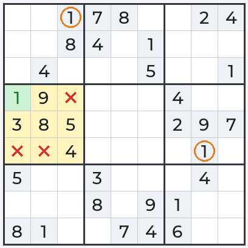

<!-- Written by tools/walkthrough.py anti-king: edit the script, not this page. -->
# Anti-King, step 1: the 1 in box 4

**Step 1 of 49** · [← The start](../anti-king.md#the-whole-puzzle-step-by-step) · [All steps](../anti-king.md#the-whole-puzzle-step-by-step) · [Step 2 →](step-02.md)

Box 4 needs a 1. r4c3: column 3 has one (r1c3). r6c1 and r6c2: row 6 has one (r6c8). Only **r4c1** is left: **r4c1 = 1**.

**Step 1 of 49** · [← The start](../anti-king.md#the-whole-puzzle-step-by-step) · [All steps](../anti-king.md#the-whole-puzzle-step-by-step) · [Step 2 →](step-02.md)
