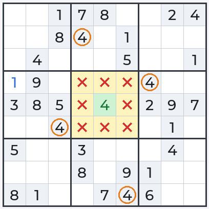

<!-- Written by tools/walkthrough.py anti-king: edit the script, not this page. -->
# Anti-King, step 2: the 4 in box 5

**Step 2 of 49** · [← Step 1](step-01.md) · [All steps](../anti-king.md#the-whole-puzzle-step-by-step) · [Step 3 →](step-03.md)

Box 5 needs a 4. r4c4, r4c5 and r4c6: row 4 has one (r4c7). r5c4: column 4 has one (r2c4). r5c6: column 6 has one (r9c6). r6c4, r6c5 and r6c6: row 6 has one (r6c3). Only **r5c5** is left: **r5c5 = 4**.

**Step 2 of 49** · [← Step 1](step-01.md) · [All steps](../anti-king.md#the-whole-puzzle-step-by-step) · [Step 3 →](step-03.md)
