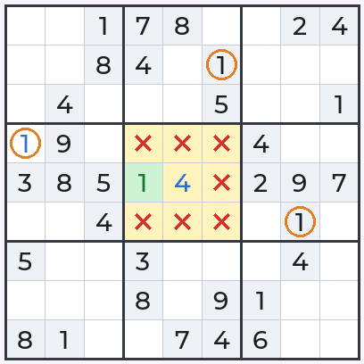

<!-- Written by tools/walkthrough.py anti-king: edit the script, not this page. -->
# Anti-King, step 3: the 1 in box 5

**Step 3 of 49** · [← Step 2](step-02.md) · [All steps](../anti-king.md#the-whole-puzzle-step-by-step) · [Step 4 →](step-04.md)

Box 5 needs a 1. r4c4, r4c5 and r4c6: row 4 has one (r4c1). r5c6: column 6 has one (r2c6). r6c4, r6c5 and r6c6: row 6 has one (r6c8). Only **r5c4** is left: **r5c4 = 1**.

**Step 3 of 49** · [← Step 2](step-02.md) · [All steps](../anti-king.md#the-whole-puzzle-step-by-step) · [Step 4 →](step-04.md)
