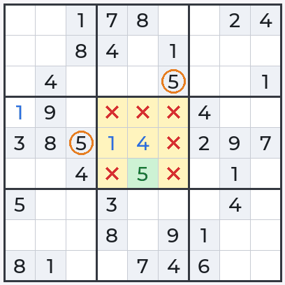

<!-- Written by tools/walkthrough.py anti-king: edit the script, not this page. -->
# Anti-King, step 4: the 5 in box 5

**Step 4 of 49** · [← Step 3](step-03.md) · [All steps](../anti-king.md#the-whole-puzzle-step-by-step) · [Step 5 →](step-05.md)

Box 5 needs a 5. r4c4 and r6c4: touch the 5 in r5c3 at a corner. r4c5: touches the 5 in r3c6 at a corner. r4c6 and r6c6: column 6 has one (r3c6). r5c6: row 5 has one (r5c3). Only **r6c5** is left: **r6c5 = 5**.

**Step 4 of 49** · [← Step 3](step-03.md) · [All steps](../anti-king.md#the-whole-puzzle-step-by-step) · [Step 5 →](step-05.md)
