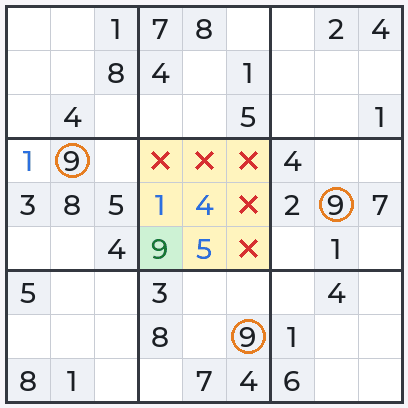

<!-- Written by tools/walkthrough.py anti-king: edit the script, not this page. -->
# Anti-King, step 5: the 9 in box 5

**Step 5 of 49** · [← Step 4](step-04.md) · [All steps](../anti-king.md#the-whole-puzzle-step-by-step) · [Step 6 →](step-06.md)

Box 5 needs a 9. r4c4, r4c5 and r4c6: row 4 has one (r4c2). r5c6: row 5 has one (r5c8). r6c6: column 6 has one (r8c6). Only **r6c4** is left: **r6c4 = 9**.

**Step 5 of 49** · [← Step 4](step-04.md) · [All steps](../anti-king.md#the-whole-puzzle-step-by-step) · [Step 6 →](step-06.md)
