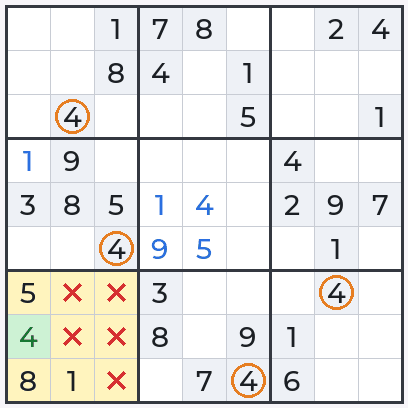

<!-- Written by tools/walkthrough.py anti-king: edit the script, not this page. -->
# Anti-King, step 6: the 4 in box 7

**Step 6 of 49** · [← Step 5](step-05.md) · [All steps](../anti-king.md#the-whole-puzzle-step-by-step) · [Step 7 →](step-07.md)

Box 7 needs a 4. r7c2 and r7c3: row 7 has one (r7c8). r8c2: column 2 has one (r3c2). r8c3: column 3 has one (r6c3). r9c3: row 9 has one (r9c6). Only **r8c1** is left: **r8c1 = 4**.

**Step 6 of 49** · [← Step 5](step-05.md) · [All steps](../anti-king.md#the-whole-puzzle-step-by-step) · [Step 7 →](step-07.md)
