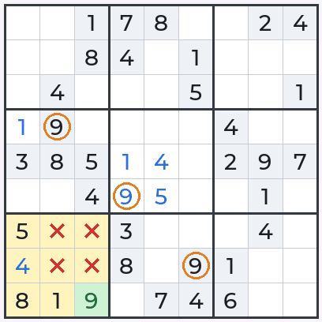

<!-- Written by tools/walkthrough.py anti-king: edit the script, not this page. -->
# Anti-King, step 7: the 9 in box 7

**Step 7 of 49** · [← Step 6](step-06.md) · [All steps](../anti-king.md#the-whole-puzzle-step-by-step) · [Step 8 →](step-08.md)

Box 7 needs a 9. r7c2: column 2 has one (r4c2). r7c3: touches the 9 in r6c4 at a corner. r8c2 and r8c3: row 8 has one (r8c6). Only **r9c3** is left: **r9c3 = 9**.

**Step 7 of 49** · [← Step 6](step-06.md) · [All steps](../anti-king.md#the-whole-puzzle-step-by-step) · [Step 8 →](step-08.md)
