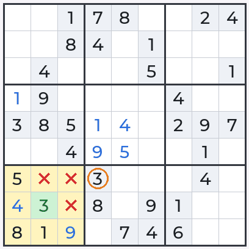

<!-- Written by tools/walkthrough.py anti-king: edit the script, not this page. -->
# Anti-King, step 8: the 3 in box 7

**Step 8 of 49** · [← Step 7](step-07.md) · [All steps](../anti-king.md#the-whole-puzzle-step-by-step) · [Step 9 →](step-09.md)

Box 7 needs a 3. r7c2 and r7c3: row 7 has one (r7c4). r8c3: touches the 3 in r7c4 at a corner. Only **r8c2** is left: **r8c2 = 3**.

**Step 8 of 49** · [← Step 7](step-07.md) · [All steps](../anti-king.md#the-whole-puzzle-step-by-step) · [Step 9 →](step-09.md)
