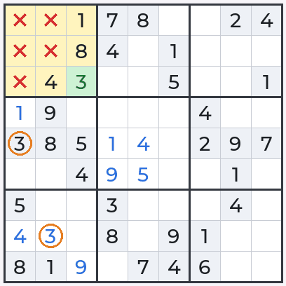

<!-- Written by tools/walkthrough.py anti-king: edit the script, not this page. -->
# Anti-King, step 9: the 3 in box 1

**Step 9 of 49** · [← Step 8](step-08.md) · [All steps](../anti-king.md#the-whole-puzzle-step-by-step) · [Step 10 →](step-10.md)

Box 1 needs a 3. r1c1, r2c1 and r3c1: column 1 has one (r5c1). r1c2 and r2c2: column 2 has one (r8c2). Only **r3c3** is left: **r3c3 = 3**.

**Step 9 of 49** · [← Step 8](step-08.md) · [All steps](../anti-king.md#the-whole-puzzle-step-by-step) · [Step 10 →](step-10.md)
