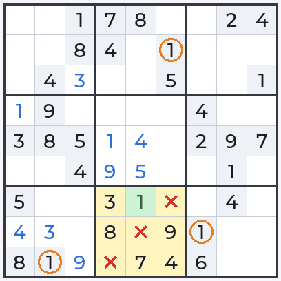

<!-- Written by tools/walkthrough.py anti-king: edit the script, not this page. -->
# Anti-King, step 10: the 1 in box 8

**Step 10 of 49** · [← Step 9](step-09.md) · [All steps](../anti-king.md#the-whole-puzzle-step-by-step) · [Step 11 →](step-11.md)

Box 8 needs a 1. r7c6: column 6 has one (r2c6). r8c5: row 8 has one (r8c7). r9c4: row 9 has one (r9c2). Only **r7c5** is left: **r7c5 = 1**.

**Step 10 of 49** · [← Step 9](step-09.md) · [All steps](../anti-king.md#the-whole-puzzle-step-by-step) · [Step 11 →](step-11.md)
