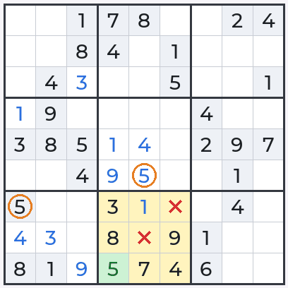

<!-- Written by tools/walkthrough.py anti-king: edit the script, not this page. -->
# Anti-King, step 11: the 5 in box 8

**Step 11 of 49** · [← Step 10](step-10.md) · [All steps](../anti-king.md#the-whole-puzzle-step-by-step) · [Step 12 →](step-12.md)

Box 8 needs a 5. r7c6: row 7 has one (r7c1). r8c5: column 5 has one (r6c5). Only **r9c4** is left: **r9c4 = 5**.

**Step 11 of 49** · [← Step 10](step-10.md) · [All steps](../anti-king.md#the-whole-puzzle-step-by-step) · [Step 12 →](step-12.md)
