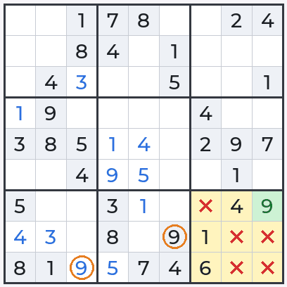

<!-- Written by tools/walkthrough.py anti-king: edit the script, not this page. -->
# Anti-King, step 12: the 9 in box 9

**Step 12 of 49** · [← Step 11](step-11.md) · [All steps](../anti-king.md#the-whole-puzzle-step-by-step) · [Step 13 →](step-13.md)

Box 9 needs a 9. r7c7: touches the 9 in r8c6 at a corner. r8c8 and r8c9: row 8 has one (r8c6). r9c8 and r9c9: row 9 has one (r9c3). Only **r7c9** is left: **r7c9 = 9**.

**Step 12 of 49** · [← Step 11](step-11.md) · [All steps](../anti-king.md#the-whole-puzzle-step-by-step) · [Step 13 →](step-13.md)
