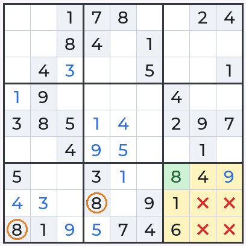

<!-- Written by tools/walkthrough.py anti-king: edit the script, not this page. -->
# Anti-King, step 13: the 8 in box 9

**Step 13 of 49** · [← Step 12](step-12.md) · [All steps](../anti-king.md#the-whole-puzzle-step-by-step) · [Step 14 →](step-14.md)

Box 9 needs an 8. r8c8 and r8c9: row 8 has one (r8c4). r9c8 and r9c9: row 9 has one (r9c1). Only **r7c7** is left: **r7c7 = 8**.

**Step 13 of 49** · [← Step 12](step-12.md) · [All steps](../anti-king.md#the-whole-puzzle-step-by-step) · [Step 14 →](step-14.md)
