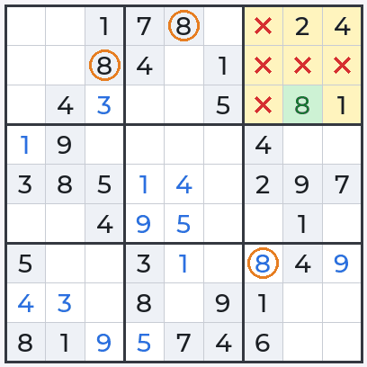

<!-- Written by tools/walkthrough.py anti-king: edit the script, not this page. -->
# Anti-King, step 14: the 8 in box 3

**Step 14 of 49** · [← Step 13](step-13.md) · [All steps](../anti-king.md#the-whole-puzzle-step-by-step) · [Step 15 →](step-15.md)

Box 3 needs an 8. r1c7: row 1 has one (r1c5). r2c7, r2c8 and r2c9: row 2 has one (r2c3). r3c7: column 7 has one (r7c7). Only **r3c8** is left: **r3c8 = 8**.

**Step 14 of 49** · [← Step 13](step-13.md) · [All steps](../anti-king.md#the-whole-puzzle-step-by-step) · [Step 15 →](step-15.md)
