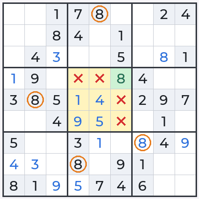

<!-- Written by tools/walkthrough.py anti-king: edit the script, not this page. -->
# Anti-King, step 15: the 8 in box 5

**Step 15 of 49** · [← Step 14](step-14.md) · [All steps](../anti-king.md#the-whole-puzzle-step-by-step) · [Step 16 →](step-16.md)

Box 5 needs an 8. r4c4: column 4 has one (r8c4). r4c5: column 5 has one (r1c5). r5c6: row 5 has one (r5c2). r6c6: touches the 8 in r7c7 at a corner. Only **r4c6** is left: **r4c6 = 8**.

**Step 15 of 49** · [← Step 14](step-14.md) · [All steps](../anti-king.md#the-whole-puzzle-step-by-step) · [Step 16 →](step-16.md)
