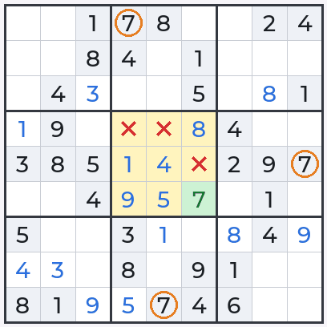

<!-- Written by tools/walkthrough.py anti-king: edit the script, not this page. -->
# Anti-King, step 16: the 7 in box 5

**Step 16 of 49** · [← Step 15](step-15.md) · [All steps](../anti-king.md#the-whole-puzzle-step-by-step) · [Step 17 →](step-17.md)

Box 5 needs a 7. r4c4: column 4 has one (r1c4). r4c5: column 5 has one (r9c5). r5c6: row 5 has one (r5c9). Only **r6c6** is left: **r6c6 = 7**.

**Step 16 of 49** · [← Step 15](step-15.md) · [All steps](../anti-king.md#the-whole-puzzle-step-by-step) · [Step 17 →](step-17.md)
