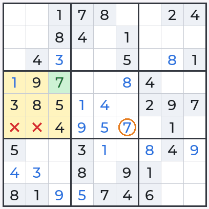

<!-- Written by tools/walkthrough.py anti-king: edit the script, not this page. -->
# Anti-King, step 17: the 7 in box 4

**Step 17 of 49** · [← Step 16](step-16.md) · [All steps](../anti-king.md#the-whole-puzzle-step-by-step) · [Step 18 →](step-18.md)

Box 4 needs a 7. r6c1 and r6c2: row 6 has one (r6c6). Only **r4c3** is left: **r4c3 = 7**.

**Step 17 of 49** · [← Step 16](step-16.md) · [All steps](../anti-king.md#the-whole-puzzle-step-by-step) · [Step 18 →](step-18.md)
