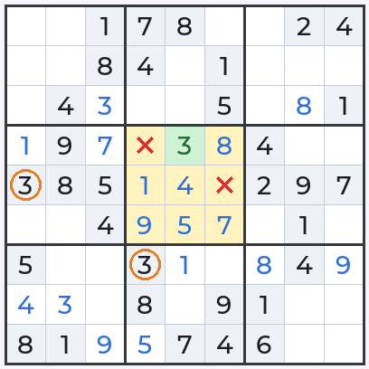

<!-- Written by tools/walkthrough.py anti-king: edit the script, not this page. -->
# Anti-King, step 18: the 3 in box 5

**Step 18 of 49** · [← Step 17](step-17.md) · [All steps](../anti-king.md#the-whole-puzzle-step-by-step) · [Step 19 →](step-19.md)

Box 5 needs a 3. r4c4: column 4 has one (r7c4). r5c6: row 5 has one (r5c1). Only **r4c5** is left: **r4c5 = 3**.

**Step 18 of 49** · [← Step 17](step-17.md) · [All steps](../anti-king.md#the-whole-puzzle-step-by-step) · [Step 19 →](step-19.md)
