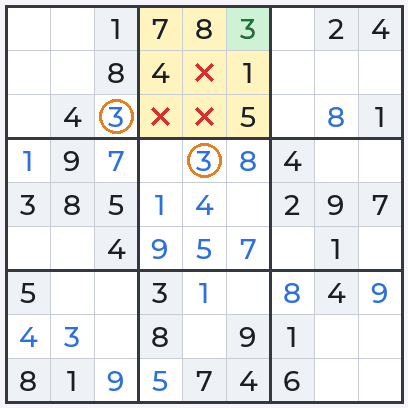

<!-- Written by tools/walkthrough.py anti-king: edit the script, not this page. -->
# Anti-King, step 19: the 3 in box 2

**Step 19 of 49** · [← Step 18](step-18.md) · [All steps](../anti-king.md#the-whole-puzzle-step-by-step) · [Step 20 →](step-20.md)

Box 2 needs a 3. r2c5: column 5 has one (r4c5). r3c4 and r3c5: row 3 has one (r3c3). Only **r1c6** is left: **r1c6 = 3**.

**Step 19 of 49** · [← Step 18](step-18.md) · [All steps](../anti-king.md#the-whole-puzzle-step-by-step) · [Step 20 →](step-20.md)
