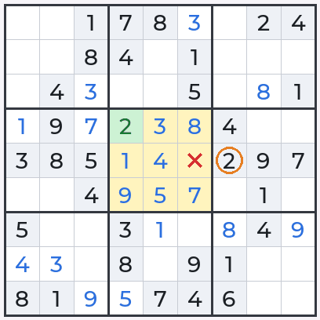

<!-- Written by tools/walkthrough.py anti-king: edit the script, not this page. -->
# Anti-King, step 20: the 2 in box 5

**Step 20 of 49** · [← Step 19](step-19.md) · [All steps](../anti-king.md#the-whole-puzzle-step-by-step) · [Step 21 →](step-21.md)

Box 5 needs a 2. r5c6: row 5 has one (r5c7). Only **r4c4** is left: **r4c4 = 2**.

**Step 20 of 49** · [← Step 19](step-19.md) · [All steps](../anti-king.md#the-whole-puzzle-step-by-step) · [Step 21 →](step-21.md)
