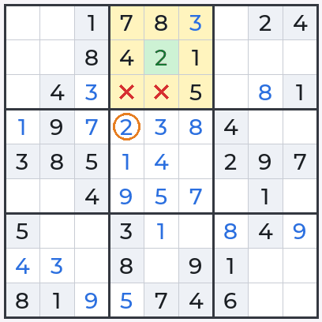

<!-- Written by tools/walkthrough.py anti-king: edit the script, not this page. -->
# Anti-King, step 21: the 2 in box 2

**Step 21 of 49** · [← Step 20](step-20.md) · [All steps](../anti-king.md#the-whole-puzzle-step-by-step) · [Step 22 →](step-22.md)

Box 2 needs a 2. r3c4: column 4 has one (r4c4). r3c5: touches the 2 in r4c4 at a corner. Only **r2c5** is left: **r2c5 = 2**.

**Step 21 of 49** · [← Step 20](step-20.md) · [All steps](../anti-king.md#the-whole-puzzle-step-by-step) · [Step 22 →](step-22.md)
