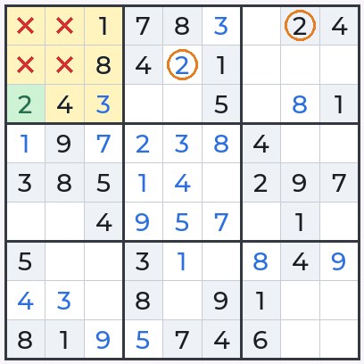

<!-- Written by tools/walkthrough.py anti-king: edit the script, not this page. -->
# Anti-King, step 22: the 2 in box 1

**Step 22 of 49** · [← Step 21](step-21.md) · [All steps](../anti-king.md#the-whole-puzzle-step-by-step) · [Step 23 →](step-23.md)

Box 1 needs a 2. r1c1 and r1c2: row 1 has one (r1c8). r2c1 and r2c2: row 2 has one (r2c5). Only **r3c1** is left: **r3c1 = 2**.

**Step 22 of 49** · [← Step 21](step-21.md) · [All steps](../anti-king.md#the-whole-puzzle-step-by-step) · [Step 23 →](step-23.md)
