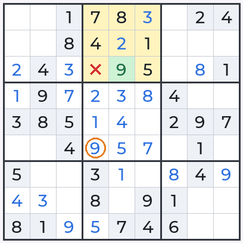

<!-- Written by tools/walkthrough.py anti-king: edit the script, not this page. -->
# Anti-King, step 23: the 9 in box 2

**Step 23 of 49** · [← Step 22](step-22.md) · [All steps](../anti-king.md#the-whole-puzzle-step-by-step) · [Step 24 →](step-24.md)

Box 2 needs a 9. r3c4: column 4 has one (r6c4). Only **r3c5** is left: **r3c5 = 9**.

**Step 23 of 49** · [← Step 22](step-22.md) · [All steps](../anti-king.md#the-whole-puzzle-step-by-step) · [Step 24 →](step-24.md)
