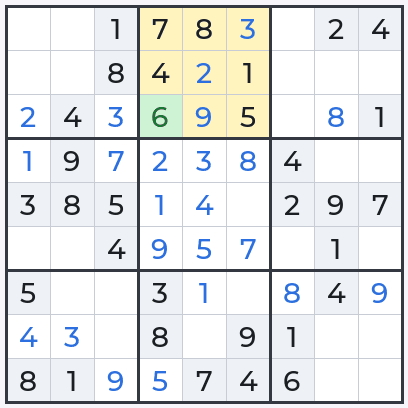

<!-- Written by tools/walkthrough.py anti-king: edit the script, not this page. -->
# Anti-King, step 24: the 6 in box 2

**Step 24 of 49** · [← Step 23](step-23.md) · [All steps](../anti-king.md#the-whole-puzzle-step-by-step) · [Step 25 →](step-25.md)

Box 2 needs a 6, and r3c4 is its last empty cell: **r3c4 = 6**.

**Step 24 of 49** · [← Step 23](step-23.md) · [All steps](../anti-king.md#the-whole-puzzle-step-by-step) · [Step 25 →](step-25.md)
