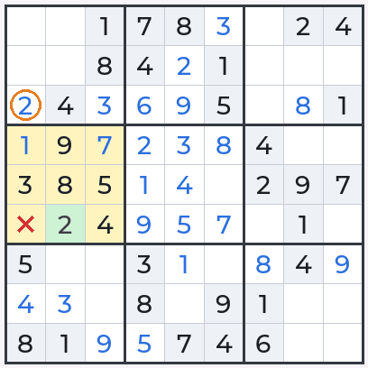

<!-- Written by tools/walkthrough.py anti-king: edit the script, not this page. -->
# Anti-King, step 25: the 2 in box 4

**Step 25 of 49** · [← Step 24](step-24.md) · [All steps](../anti-king.md#the-whole-puzzle-step-by-step) · [Step 26 →](step-26.md)

Box 4 needs a 2. r6c1: column 1 has one (r3c1). Only **r6c2** is left: **r6c2 = 2**.

**Step 25 of 49** · [← Step 24](step-24.md) · [All steps](../anti-king.md#the-whole-puzzle-step-by-step) · [Step 26 →](step-26.md)
