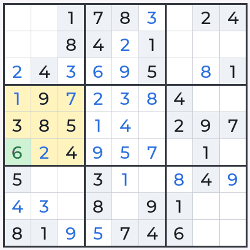

<!-- Written by tools/walkthrough.py anti-king: edit the script, not this page. -->
# Anti-King, step 26: the 6 in box 4

**Step 26 of 49** · [← Step 25](step-25.md) · [All steps](../anti-king.md#the-whole-puzzle-step-by-step) · [Step 27 →](step-27.md)

Box 4 needs a 6, and r6c1 is its last empty cell: **r6c1 = 6**.

**Step 26 of 49** · [← Step 25](step-25.md) · [All steps](../anti-king.md#the-whole-puzzle-step-by-step) · [Step 27 →](step-27.md)
