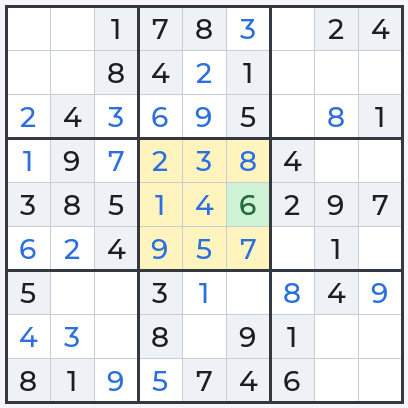

<!-- Written by tools/walkthrough.py anti-king: edit the script, not this page. -->
# Anti-King, step 27: the 6 in box 5

**Step 27 of 49** · [← Step 26](step-26.md) · [All steps](../anti-king.md#the-whole-puzzle-step-by-step) · [Step 28 →](step-28.md)

Box 5 needs a 6, and r5c6 is its last empty cell: **r5c6 = 6**.

**Step 27 of 49** · [← Step 26](step-26.md) · [All steps](../anti-king.md#the-whole-puzzle-step-by-step) · [Step 28 →](step-28.md)
