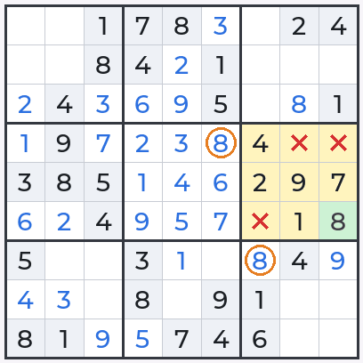

<!-- Written by tools/walkthrough.py anti-king: edit the script, not this page. -->
# Anti-King, step 28: the 8 in box 6

**Step 28 of 49** · [← Step 27](step-27.md) · [All steps](../anti-king.md#the-whole-puzzle-step-by-step) · [Step 29 →](step-29.md)

Box 6 needs an 8. r4c8 and r4c9: row 4 has one (r4c6). r6c7: column 7 has one (r7c7). Only **r6c9** is left: **r6c9 = 8**.

**Step 28 of 49** · [← Step 27](step-27.md) · [All steps](../anti-king.md#the-whole-puzzle-step-by-step) · [Step 29 →](step-29.md)
