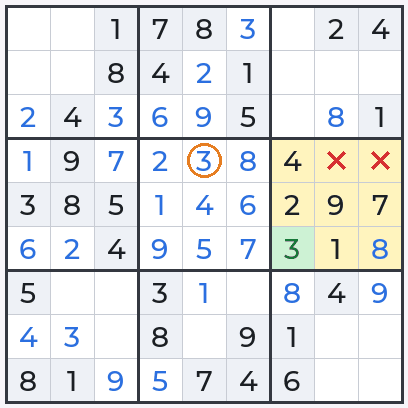

<!-- Written by tools/walkthrough.py anti-king: edit the script, not this page. -->
# Anti-King, step 29: the 3 in box 6

**Step 29 of 49** · [← Step 28](step-28.md) · [All steps](../anti-king.md#the-whole-puzzle-step-by-step) · [Step 30 →](step-30.md)

Box 6 needs a 3. r4c8 and r4c9: row 4 has one (r4c5). Only **r6c7** is left: **r6c7 = 3**.

**Step 29 of 49** · [← Step 28](step-28.md) · [All steps](../anti-king.md#the-whole-puzzle-step-by-step) · [Step 30 →](step-30.md)
