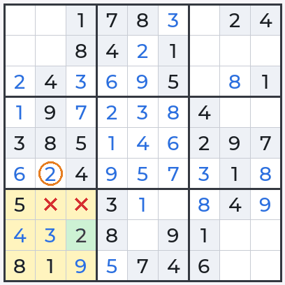

<!-- Written by tools/walkthrough.py anti-king: edit the script, not this page. -->
# Anti-King, step 30: the 2 in box 7

**Step 30 of 49** · [← Step 29](step-29.md) · [All steps](../anti-king.md#the-whole-puzzle-step-by-step) · [Step 31 →](step-31.md)

Box 7 needs a 2. r7c2: column 2 has one (r6c2). r7c3: touches the 2 in r6c2 at a corner. Only **r8c3** is left: **r8c3 = 2**.

**Step 30 of 49** · [← Step 29](step-29.md) · [All steps](../anti-king.md#the-whole-puzzle-step-by-step) · [Step 31 →](step-31.md)
