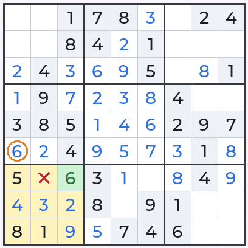

<!-- Written by tools/walkthrough.py anti-king: edit the script, not this page. -->
# Anti-King, step 31: the 6 in box 7

**Step 31 of 49** · [← Step 30](step-30.md) · [All steps](../anti-king.md#the-whole-puzzle-step-by-step) · [Step 32 →](step-32.md)

Box 7 needs a 6. r7c2: touches the 6 in r6c1 at a corner. Only **r7c3** is left: **r7c3 = 6**.

**Step 31 of 49** · [← Step 30](step-30.md) · [All steps](../anti-king.md#the-whole-puzzle-step-by-step) · [Step 32 →](step-32.md)
