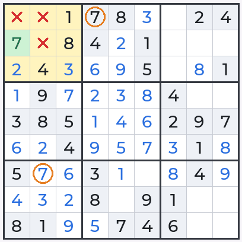

<!-- Written by tools/walkthrough.py anti-king: edit the script, not this page. -->
# Anti-King, step 33: the 7 in box 1

**Step 33 of 49** · [← Step 32](step-32.md) · [All steps](../anti-king.md#the-whole-puzzle-step-by-step) · [Step 34 →](step-34.md)

Box 1 needs a 7. r1c1 and r1c2: row 1 has one (r1c4). r2c2: column 2 has one (r7c2). Only **r2c1** is left: **r2c1 = 7**.

**Step 33 of 49** · [← Step 32](step-32.md) · [All steps](../anti-king.md#the-whole-puzzle-step-by-step) · [Step 34 →](step-34.md)
