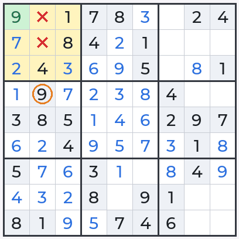

<!-- Written by tools/walkthrough.py anti-king: edit the script, not this page. -->
# Anti-King, step 34: the 9 in box 1

**Step 34 of 49** · [← Step 33](step-33.md) · [All steps](../anti-king.md#the-whole-puzzle-step-by-step) · [Step 35 →](step-35.md)

Box 1 needs a 9. r1c2 and r2c2: column 2 has one (r4c2). Only **r1c1** is left: **r1c1 = 9**.

**Step 34 of 49** · [← Step 33](step-33.md) · [All steps](../anti-king.md#the-whole-puzzle-step-by-step) · [Step 35 →](step-35.md)
