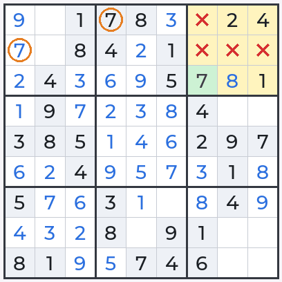

<!-- Written by tools/walkthrough.py anti-king: edit the script, not this page. -->
# Anti-King, step 35: the 7 in box 3

**Step 35 of 49** · [← Step 34](step-34.md) · [All steps](../anti-king.md#the-whole-puzzle-step-by-step) · [Step 36 →](step-36.md)

Box 3 needs a 7. r1c7: row 1 has one (r1c4). r2c7, r2c8 and r2c9: row 2 has one (r2c1). Only **r3c7** is left: **r3c7 = 7**.

**Step 35 of 49** · [← Step 34](step-34.md) · [All steps](../anti-king.md#the-whole-puzzle-step-by-step) · [Step 36 →](step-36.md)
