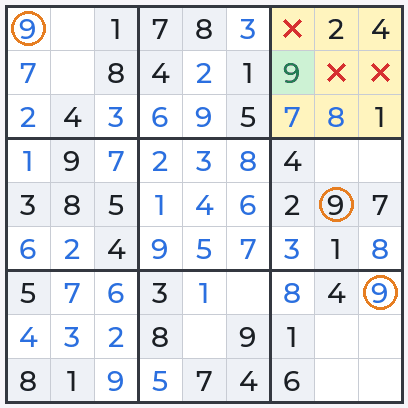

<!-- Written by tools/walkthrough.py anti-king: edit the script, not this page. -->
# Anti-King, step 36: the 9 in box 3

**Step 36 of 49** · [← Step 35](step-35.md) · [All steps](../anti-king.md#the-whole-puzzle-step-by-step) · [Step 37 →](step-37.md)

Box 3 needs a 9. r1c7: row 1 has one (r1c1). r2c8: column 8 has one (r5c8). r2c9: column 9 has one (r7c9). Only **r2c7** is left: **r2c7 = 9**.

**Step 36 of 49** · [← Step 35](step-35.md) · [All steps](../anti-king.md#the-whole-puzzle-step-by-step) · [Step 37 →](step-37.md)
