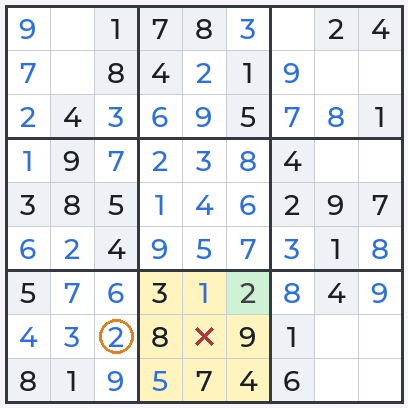

<!-- Written by tools/walkthrough.py anti-king: edit the script, not this page. -->
# Anti-King, step 37: the 2 in box 8

**Step 37 of 49** · [← Step 36](step-36.md) · [All steps](../anti-king.md#the-whole-puzzle-step-by-step) · [Step 38 →](step-38.md)

Box 8 needs a 2. r8c5: row 8 has one (r8c3). Only **r7c6** is left: **r7c6 = 2**.

**Step 37 of 49** · [← Step 36](step-36.md) · [All steps](../anti-king.md#the-whole-puzzle-step-by-step) · [Step 38 →](step-38.md)
